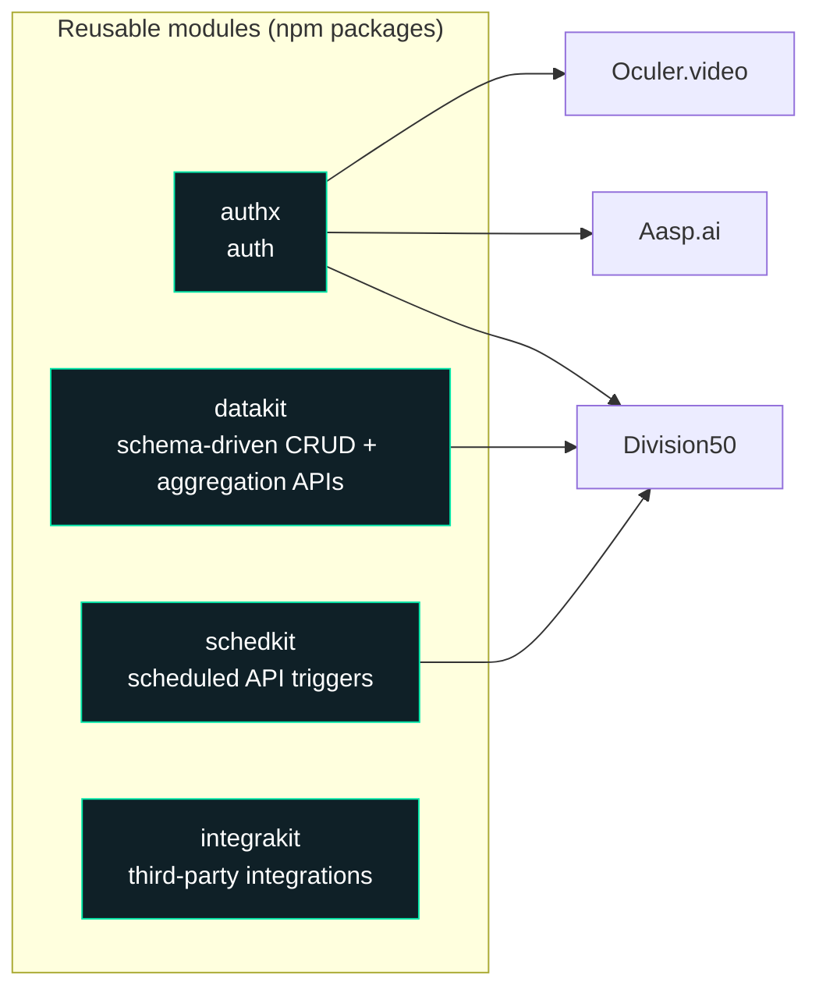

<p align="center">
  
</p>

<p align="center">
  <a href="https://linkedin.com/in/vaibhavkaushik017"></a>
  <a href="mailto:kaushikvaibhav017@gmail.com"></a>
  
</p>

## `~/about.ts`

```ts
const vaibhav = {
  role: "Software Engineer @ DCKAP",
  previously: "Software Engineer @ Zedblock (Jul 2024 – Jun 2026)",
  stack: ["TypeScript", "NestJS", "Next.js", "MongoDB", "LiveKit", "Remotion"],
  shipped: {
    aiVideoGenerator: "Oculer.video",
    realtimeVoiceAgent: "WebSockets + LiveKit",
    aiWebsiteBuilder: "Aasp.ai",
    aiMarketingPlatform: "Division50 (lead dev, built in under a month)",
    npmPackages: ["authx", "datakit", "schedkit", "integrakit"],
  },
  buildingOnTheSide: "TourFlips: AI travel guide for Indian domestic trips",
  lookingFor: "high-ownership roles on scalable, AI-first products",
} as const;
```

## 🧩 How I build: one set of modules, many products

I turned recurring backend needs into reusable NestJS modules, then used them to ship whole products fast.



## 🛠️ Arsenal

<p align="center">
  
</p>

| | |
|---|---|
| **Real-time and AI** | WebSockets · LiveKit · WebRTC · Remotion · ElevenLabs · Google Gemini |
| **Auth and payments** | JWT · OAuth · Keycloak · Razorpay · Dodo Payments |
| **Infra** | GCP Cloud Run · Hetzner · PM2 · Coolify · GitHub Actions |

## 🔥 Shipped

<details>
<summary><b>Oculer.video</b>: AI text-to-video generator</summary>
<br>

- Next.js dashboard (123+ commits): Remotion-based player, export queue with progress tracking, template selection, brand kits, ElevenLabs voice
- Payment service from scratch in NestJS (112+ commits): Razorpay subscription lifecycle, webhooks, plan enforcement, usage metering
- Auth service (65+ commits): JWT, Google OAuth, onboarding, role-based sessions
- Deployed to GCP Cloud Run, with the render workers on Hetzner via SSH and PM2
</details>

<details>
<summary><b>Real-time AI voice calling agent</b></summary>
<br>

- NestJS backend handling WebSocket sessions, realtime audio streaming and the agent state machine
- Next.js call UI with connection status, audio visualization and session controls
- LiveKit tools-server so the agent can call APIs and look up data mid-conversation
</details>

<details>
<summary><b>Aasp.ai</b>: AI website builder with one-click deploy</summary>
<br>

- Admin panel and dashboard in Next.js for generated sites, users and deployment status
- Auth service (custom + Keycloak) and payments (Razorpay + Dodo Payments)
- One-click pipeline to publish a generated site to production
</details>

<details>
<summary><b>Division50</b>: AI marketing platform (lead developer)</summary>
<br>

- Delivered the full platform in under a month by reusing the modules above
- Backend APIs generated through the Data Module, including aggregation pipelines
</details>

<details>
<summary><b>DCKAP Integrator</b>: ERP-first integration platform</summary>
<br>

- Led the frontend migration to TypeScript with incremental adoption alongside the existing JavaScript
- Shipped AI-powered workflow summaries, scheduler validation, credential management and DataHub improvements
- Wrote technical requirement documents and assessed backward compatibility for new capabilities
</details>

## 🌱 Currently building

**TourFlips**: an AI-powered travel guide for Indian domestic trips (NestJS, Next.js, Supabase Postgres, Redis, Gemini).

## 🐍 Contribution snake

<p align="center">
  <picture>
    <source media="(prefers-color-scheme: dark)" srcset="https://raw.githubusercontent.com/VaibhavKaushik017/VaibhavKaushik017/output/github-snake-dark.svg" />
    <source media="(prefers-color-scheme: light)" srcset="https://raw.githubusercontent.com/VaibhavKaushik017/VaibhavKaushik017/output/github-snake.svg" />
    
  </picture>
</p>

## 📊 Stats

<p align="center">
  
  
</p>

<sub>Most of my work lives in private company repositories, so the public graph understates what I ship.</sub>


